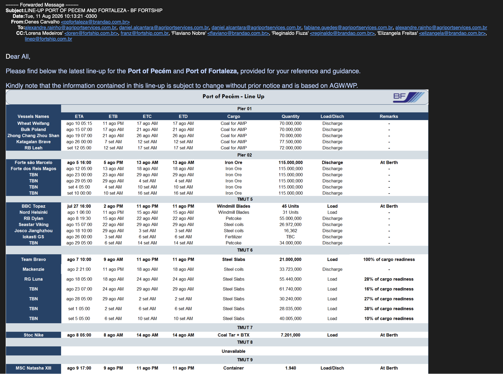
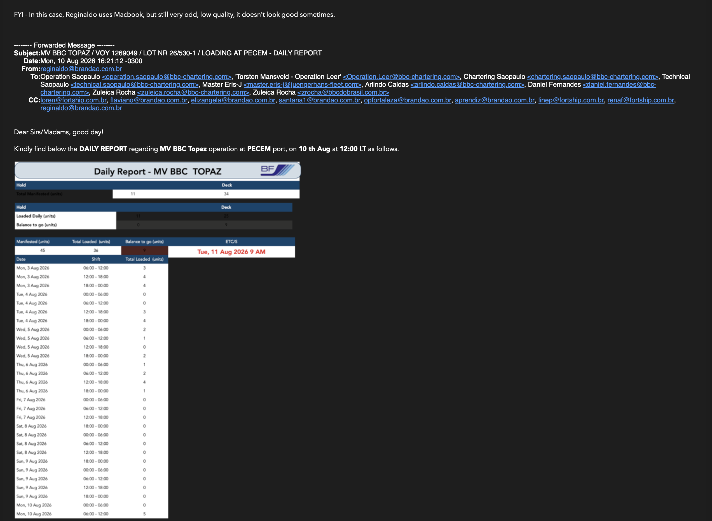
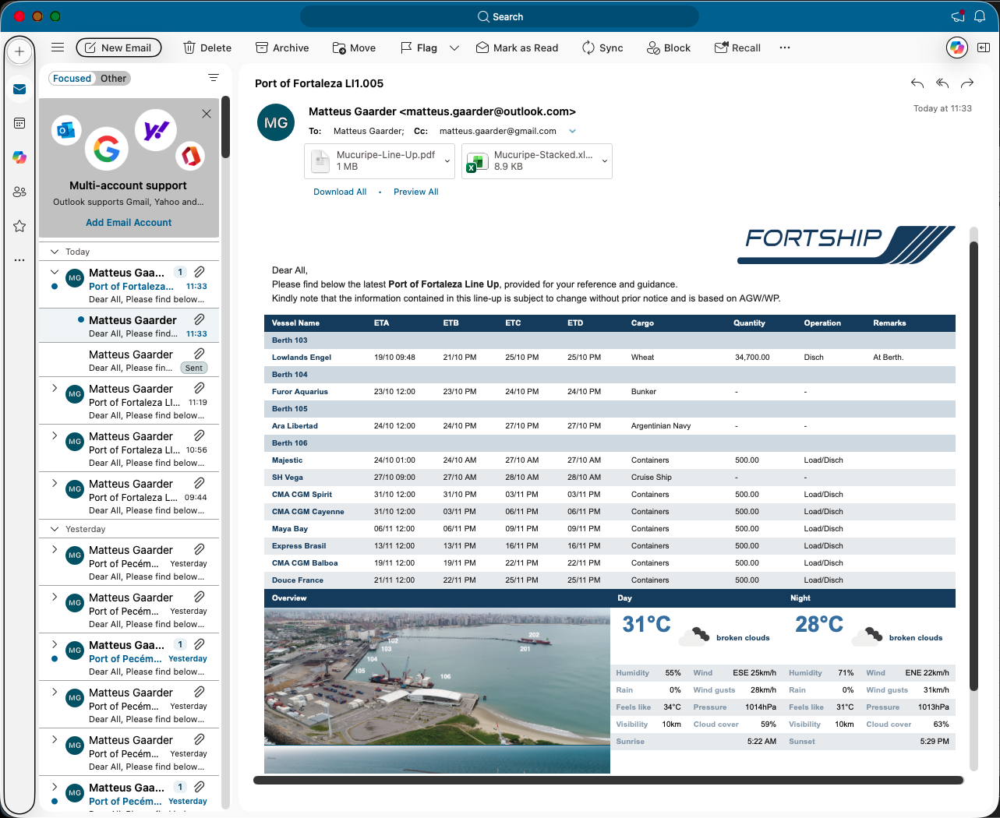
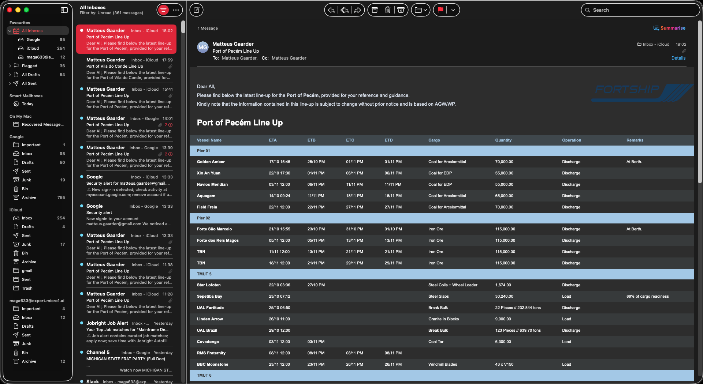
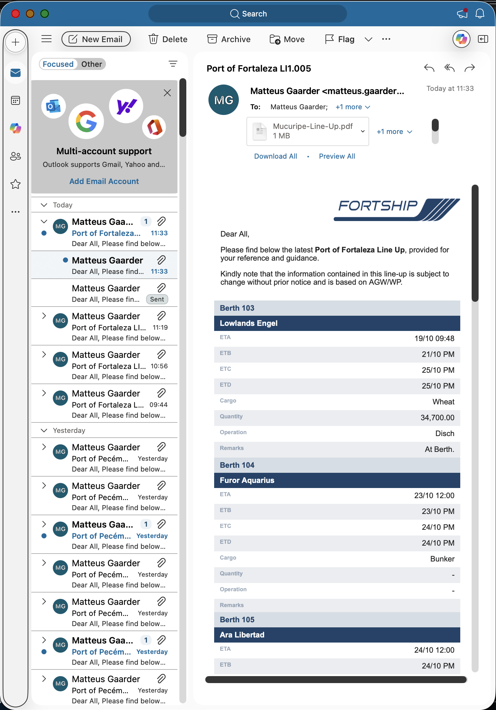
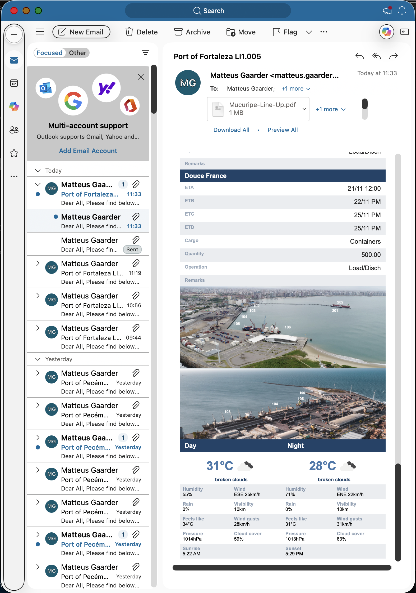
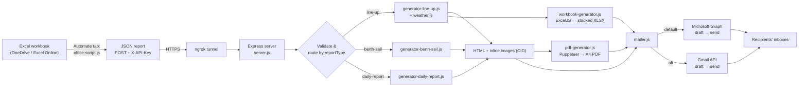

# Lorena HTML — Automated Shipping Report Emailer

> One click in Excel → a polished, responsive, branded email (plus PDF and XLSX attachments) lands in the right inboxes.

Lorena HTML turns the shipping-agency spreadsheets used at **Fortship** (port line-ups, berthing/sailing reports and vessel daily reports) into professional, ready-to-send emails — automatically. An **Excel Office Script** reads the active worksheet, posts it as JSON through an **ngrok** tunnel to a **Node.js/Express** server, which renders HTML, builds a PDF and a formatted workbook, creates the email via **Microsoft Graph** (or Gmail) and sends it.

---

## Table of Contents

1. [The Problem](#the-problem)
2. [The Solution](#the-solution)
3. [Visual Transformation: Old vs. New](#visual-transformation-old-vs-new)
4. [Pipeline Overview](#pipeline-overview)
5. [Report Types](#report-types)
6. [Technologies Used](#technologies-used)
7. [Techniques & Design Decisions](#techniques--design-decisions)
8. [Project Structure](#project-structure)
9. [API Reference](#api-reference)
10. [Setup & Configuration](#setup--configuration)
11. [Running the Project](#running-the-project)
12. [Local Preview & Testing](#local-preview--testing)
13. [Security Notes](#security-notes)
14. [Known Limitations / Future Work](#known-limitations--future-work)

---

## The Problem

Port agency operations depend on several recurring Excel workbooks (`LINEUP.xlsx` and friends), each with tabs per port or report:

- **Line-Ups** — vessels queued per berth/pier for Mucuripe/Fortaleza, Pecém, Vila do Conde, Tank Pier and Recife.
- **Berth & Sail** — berthing and sailing status.
- **Daily Reports** — per-vessel cargo discharge/loading progress by shift.

Before this project, the workflow was entirely manual:

1. Open the workbook and select the relevant range.
2. **Take a screenshot** of the cells.
3. Paste/attach it into a new email, retype the greeting, recipients and subject.
4. Repeat for each port and report, several times a day.

This had real costs:

| Pain point | Consequence |
|---|---|
| Screenshots are images | Text cannot be selected or copied; unreadable for screen readers and search |
| Fixed resolution | Blurry/low quality, especially on Retina and dark-mode clients (see the old screenshots below) |
| Wide tables as images | Not legible on phones — recipients must pinch and zoom |
| Manual recipient entry | Risk of typos and wrong To/CC/BCC lists |
| Repetitive effort | Time wasted on every send; inconsistent format between senders |
| No context | No weather, port imagery or consistent branding |

## The Solution

A pipeline that makes sending a report a **single action in Excel**:

- **Data is read directly from the sheet** — no screenshots.
- **Recipients are managed in Excel** (`HOME` sheet cells `F2:F4` for To/CC/BCC).
- The server renders **real, responsive HTML** — a desktop table and a mobile card layout in the same email.
- **Branded**: Fortship logo, port aerial image, colour palette.
- **Enriched**: line-ups include a live **weather forecast** (day and night) for the port.
- **Attachments are generated automatically**: a printable A4 **PDF** of the report and, for line-ups, a formatted **stacked XLSX**.
- The email is created and **sent through the Microsoft Graph API** (Gmail also supported).

---

## Visual Transformation: Old vs. New

### Before — screenshots pasted into emails

The legacy process pasted an Excel screenshot into the email body. The recipient sees a flat bitmap: it can't be reflowed, scaled, searched, or restyled for dark mode, and it frequently looks blurry.

**Line-up (old):**



**Daily report (old):**



> Notice the pixelated text, dark-mode rendering issues (labels that disappear on a dark background), the huge forwarded-header block, and a very long single image on the daily report. The note on the screenshot itself reads: *"still very odd, low quality, it doesn't look good sometimes."*

### After — generated HTML email

**Desktop / wide (light mode)** — a clean branded header, intro text, a berth-grouped table with zebra striping, then a port overview photo next to day/night weather panels. The PDF and stacked XLSX are attached automatically.



**Desktop / wide (dark mode)** — the same template adapts to dark-mode mail clients.



**Narrow / mobile (light mode)** — below 600 px the table switches to **stacked vessel cards** (label/value pairs) that need no horizontal scrolling.





### Side-by-side summary

| Aspect | Old (screenshot) | New (generated) |
|---|---|---|
| Content type | Bitmap image | Real HTML text and tables |
| Text selectable / searchable | No | Yes |
| Sharpness | Blurry, depends on screenshot | Crisp at any zoom / DPI |
| Mobile | Pinch-to-zoom | Responsive card layout |
| Dark mode | Often illegible | Readable |
| Branding | Inconsistent | Fortship logo and palette |
| Extra context | None | Port photo, weather, timestamps |
| Attachments | Manual | Auto PDF + stacked XLSX |
| Recipients | Typed by hand | Read from the `HOME` sheet |
| Effort | Minutes per email | One click |

---

## Pipeline Overview



### Step by step

1. **Trigger (Excel).** The user opens a report tab and runs the script from **Automate → Office Scripts** ([office-script.js](office-script.js)). The script is the entry point and is not executed by Node.
2. **Extract.** Depending on the active worksheet name, the script parses the sheet:
   - `Mucuripe`, `Pecem`, `VDC`, `Tank Pier`, `PE` → `processLineUp`
   - `Berth&Sail` → `processBerthSail`
   - `Daily Report` → `processDailyReport`
   - Anything else throws `Unsupported report worksheet`.
   Recipients come from the `HOME` sheet (`F2` To, `F3` CC, `F4` BCC; split on `;` or `,`).
3. **Send.** `sendReport()` makes a `fetch` POST to `https://<ngrok-domain>/generate-report-json` with header `X-API-Key` and the JSON body. Office Scripts run in Microsoft's cloud, so ngrok exposes the local Node server publicly.
4. **Validate.** [server.js](server.js) applies CORS only to this endpoint, checks the API key using a timing-safe comparison, and runs strict type guards (`isLineUpReport`, `isBerthSailReport`, `isDailyReport`).
5. **Enrich (line-up only).** [config.js](config.js) maps the sheet name to a port (title, image, coordinates). [weather.js](weather.js) fetches the OpenWeather 5-day forecast and extracts "now" and the 21:00 forecast, plus sunrise and sunset.
6. **Render.** The matching generator builds email-safe HTML and a list of inline images (`cid:`).
7. **Attach.**
   - [pdf-generator.js](pdf-generator.js): Puppeteer prints the same HTML to an A4 PDF.
   - [workbook-generator.js](workbook-generator.js): for line-ups, fills a pre-formatted template (`templates/lineup-format.xlsx`) with the calculated "Stacked" sheet values.
8. **Draft and send.** [mailer.js](mailer.js) creates a draft with Microsoft Graph ([graph.js](graph.js)) or Gmail ([gmail.js](gmail.js)), then sends it.
9. **Clean up.** Temporary PDF/XLSX files are deleted in a `finally` block whether the request succeeds or fails.

---

## Report Types

### 1. Line-Up (`reportType: "line-up"`)
- Each berth/pier occupies a block of **9 columns**: Vessel, ETA, ETB, ETC, ETD, Cargo, Quantity, Load/Disch, Remarks.
- Berth names are read from row 3, headers from row 4; blocks without a `Vessels Names` header are skipped.
- Also sends `stackedData`, the evaluated values of the `<Port> - Stacked` worksheet.
- Email subject: `<Port title> LI1.005`.
- Includes port photo, day and night weather panels (temperature, humidity, wind and direction, gusts, rain chance, pressure, visibility, cloud cover, sunrise/sunset) and a "Generated" timestamp (Brazil time).
- Attachments: `<Sheet>-Line-Up.pdf` and `<Sheet>-Stacked.xlsx`.

### 2. Berth & Sail (`reportType: "berth-sail"`)
- Reads the used range of `Berth&Sail` as `label / valueB / valueC` rows (skipping row 2).
- Subject: `Berthing Report`. Attachment: `Berthing-Report.pdf`.

### 3. Daily Report (`reportType: "daily-report"`)
- Content is located by **searching for landmarks** rather than fixed cells: the `Hold`s header, known summary labels, the `Date`/`Shift` table header and the `ETC/S` cell.
- Produces vessel name, holds, summary and discharge-summary metrics, a per-shift discharge table and the ETC/S date.
- Subject: `Daily Report`. Attachment: `<Vessel>-Daily-Report.pdf`.

---

## Technologies Used

| Layer | Technology | Purpose |
|---|---|---|
| Source / trigger | **Microsoft Excel + Office Scripts** (TypeScript) | Read worksheets and POST data from the *Automate* tab |
| Tunnel | **ngrok** | Expose the local server to Microsoft's cloud |
| Server | **Node.js**, **Express 5** | HTTP API, routing, previews |
| Sessions / config | `express-session`, `dotenv`, `cors` | OAuth state, secrets, scoped CORS |
| Email (primary) | **Microsoft Graph API**, `@azure/msal-node` | OAuth, drafts, inline and file attachments, send |
| Email (alternative) | **Gmail API** (`googleapis`), `nodemailer` | Same flow via Google |
| HTML rendering | Template literals, inline CSS, `@media` queries | Email-safe responsive HTML |
| PDF | **Puppeteer** (headless Chromium) | A4 PDF attachment |
| Excel output | **ExcelJS** (and `xlsx`) | Template-preserving stacked workbook |
| Weather | **OpenWeather** forecast API (Node `fetch`) | Day/night forecast per port |
| Dev tooling | `concurrently` | Run server and ngrok together |

---

## Techniques & Design Decisions

**Excel side**
- **Typed contracts**: TypeScript interfaces (`LineUp`, `BerthSailReport`, `DailyReport`) define the payload.
- **Display text over raw values**: `range.getTexts()` keeps the dates, number formats and "PM/AM" labels exactly as users see them.
- **Block-based parsing** (9-column berth blocks) lets one sheet contain any number of berths.
- **Landmark-based parsing** in the daily report tolerates layout shifts.
- **Recipients in a sheet** (`HOME`) so non-developers can change who receives what.

**Server side**
- **Discriminated payload (`reportType`)** with a generator registry (`line-up`, `berth-sail`, `daily-report`) — adding a new report is a new generator plus a validator.
- **Defence in depth**: API key (`crypto.timingSafeEqual`), CORS limited to the machine endpoint, payload type guards, 1 MB body limit, `httpOnly`/`sameSite` cookies, random OAuth `state` checking.
- **Resilient weather**: `AbortSignal.timeout`, 3 attempts with exponential backoff (1 s × 1.5), and no retry on 400/401.
- **Temp-file hygiene**: random suffixes avoid collisions between concurrent requests and files are removed in `finally`.

**Email rendering**
- **Email-safe HTML**: table layout, inline images embedded via **CID** (`isInline` + `contentId`), no reliance on external hosting.
- **Responsive in a single email**: a `desktop-report` table and `mobile-report` cards are toggled with `@media` queries (≤600 px, and an intermediate 601–745 px breakpoint).
- **One source, two outputs**: the same HTML is reused for the PDF. `pdf-generator.js` swaps `cid:` references for base64 data URIs, strips the greeting, forces the desktop layout, applies A4 print CSS (`break-inside: avoid`, exact colours) and renders at 2× device scale.
- **Template-preserving Excel export**: ExcelJS loads `templates/lineup-format.xlsx`, keeps only the relevant sheet, writes static values (replacing formulas) and clones row styles for extra rows.

**Developer experience**
- **Live preview routes** with `require.cache` busting, so generator edits show on refresh without restarting the server.
- **Fixtures**: `LINEUP.xlsx`, `berth-sail-preview.json` and `debug-received-report.json` allow offline iteration.
- **Draft inspection**: the Graph body is read back after creation (`debug-graph-email.html`) to verify what Outlook kept after sanitising CSS.

---

## Project Structure

```
lorenahtml/
├── office-script.js          # Excel Office Script (Automate tab) — runs in Excel, not Node
├── server.js                 # Express app: API endpoint, OAuth, previews, smoke tests
├── config.js                 # Port config (title, image, coordinates) + email subject logic
├── parser.js                 # Parses LINEUP.xlsx locally for previews/tests
├── generator-line-up.js      # Line-up HTML (desktop + mobile + weather + port image)
├── email-theme.js            # Shared line-up-style CSS/shell for Berth & Sail and Daily Report
├── generator-berth-sail.js   # Berth & Sail HTML
├── generator-daily-report.js # Daily report HTML
├── weather.js                # OpenWeather client with retry/timeout
├── pdf-generator.js          # HTML → A4 PDF via Puppeteer
├── workbook-generator.js     # Stacked XLSX from template via ExcelJS
├── mailer.js                 # Provider-agnostic create/send draft
├── graph.js                  # Microsoft Graph: drafts, attachments, send, OneDrive
├── auth.js                   # Microsoft MSAL OAuth + token cache
├── gmail.js / gmail-auth.js  # Gmail drafts/send + Google OAuth
├── generate-report.js        # CLI helper for generating a preview
├── templates/lineup-format.xlsx   # Formatted workbook template
├── assets/                   # Logos, port images, weather icons, visual_transformation/
├── uploads/, archive/        # Working / legacy files
└── debug-*.html|json         # Debug artefacts
```

---

## API Reference

### `POST /generate-report-json`
Machine endpoint called by the Office Script.

| | |
|---|---|
| Headers | `Content-Type: application/json`, `X-API-Key: <API_KEY>` |
| Body | One of the `LineUp`, `BerthSailReport` or `DailyReport` shapes (see [office-script.js](office-script.js)) |
| `201` | `{ success: true, provider, draftId }` |
| `400` | Invalid shipping report |
| `401` | Unauthorized (bad or missing key) |
| `500` | Report generation failed |

Example (Berth & Sail):

```json
{
  "reportType": "berth-sail",
  "sheetName": "Berth&Sail",
  "to": ["ops@example.com"],
  "cc": [],
  "bcc": [],
  "rows": [{ "label": "Berth 103", "valueB": "Lowlands Engel", "valueC": "At berth" }]
}
```

### Browser routes

| Route | Purpose |
|---|---|
| `GET /` | Status page: provider and login links |
| `GET /google/login`, `/google/callback` | Google OAuth |
| `GET /microsoft/login`, `/microsoft/callback` | Microsoft OAuth |
| `GET /preview` | Live line-up preview (from `LINEUP.xlsx`) |
| `GET /preview/berth-sail` | Preview from `berth-sail-preview.json` |
| `GET /preview/daily-report` | Preview from `daily-report-preview.json` |
| `POST /test/:provider/draft` | Send a test email (`gmail` or `microsoft`) |
| `GET /test-weather` | Weather API check |
| `GET /test-onedrive`, `/test-onedrive-attachment` | OneDrive / Graph attachment tests |

---

## Setup & Configuration

### Prerequisites
- Node.js 18+ (uses the built-in `fetch`)
- An [ngrok](https://ngrok.com) account and CLI
- A Microsoft Entra (Azure AD) app registration (and optionally a Google Cloud OAuth client)
- An OpenWeather API key
- Excel with **Office Scripts** enabled (Excel for the web / Microsoft 365)

### Install
```bash
npm install
```

### Environment variables (`.env`, git-ignored)

| Variable | Description |
|---|---|
| `PORT` | Server port (default `3000`) |
| `NODE_ENV` | `production` enables secure cookies and trust proxy |
| `SESSION_SECRET` | **Required.** Session signing secret |
| `API_KEY` | **Required.** Shared key the Office Script sends in `X-API-Key` |
| `EMAIL_PROVIDER` | `microsoft` (default) or `gmail` |
| `MICROSOFT_CLIENT_ID`, `MICROSOFT_CLIENT_SECRET`, `MICROSOFT_TENANT_ID`, `MICROSOFT_AUTHORITY_TENANT`, `MICROSOFT_REDIRECT_URI` | Entra app settings |
| `MICROSOFT_ALLOW_SEND` | Must be `true` to send (otherwise only drafts are created) |
| `GOOGLE_CLIENT_ID`, `GOOGLE_CLIENT_SECRET`, `GOOGLE_REDIRECT_URI` | Google OAuth |
| `OPENWEATHER_API_KEY` | Weather forecasts |
| `ONEDRIVE_WORKBOOK_ID` | OneDrive workbook for attachment tests |

### Excel setup
1. Open the workbook in Excel and go to **Automate → New Script**.
2. Paste the contents of [office-script.js](office-script.js).
3. Update the URL and API key in `sendReport()` to your ngrok domain and `API_KEY`.
4. Fill the `HOME` sheet: **F2** To, **F3** CC, **F4** BCC (separated by `;` or `,`).
5. For line-ups, keep a `<Port> - Stacked` sheet (e.g. `Pecem - Stacked`) alongside each port sheet.

---

## Running the Project

```bash
# Server only
npm start

# Server + ngrok tunnel together
npm run dev
```

1. Visit `http://localhost:3000`, then **Connect Microsoft** (or Google) once to authorise sending. Tokens are cached in `microsoft-token-cache.json` / `google-token.json`.
2. Copy the ngrok HTTPS URL into the Office Script if it has changed.
3. In Excel, open the report tab and run the script. The result appears in the **Output** pane (`HTTP status: 201`).

## Local Preview & Testing

```bash
npm start
# open in a browser:
#   http://localhost:3000/preview
#   http://localhost:3000/preview/berth-sail
#   http://localhost:3000/preview/daily-report
```

Resize the window under 600 px to see the mobile card layout. `npm test` runs `node --check` syntax checks.

---

## Security Notes

- Never commit `.env`, `google-token.json` or `microsoft-token-cache.json`; they are already in `.gitignore`.
- **Rotate the `API_KEY`** and avoid hard-coding it in shared scripts: `office-script.js` currently contains the key and the ngrok URL in plain text.
- The ngrok URL exposes the endpoint to the internet; the API key is the only gate, so use a long random value and HTTPS only.
- The OAuth flows use a per-session random `state` verified with a constant-time comparison.

## Known Limitations / Future Work

- Email sending is Microsoft-only by design; the Gmail code is deprecated.
- The line-up subject uses a fixed revision string (`LI1.005`).
- Puppeteer launches a new browser per PDF; a shared instance would be faster at higher volume.
- `generator-line-up.js` contains a large commented-out legacy template that can be removed.
- Replace ngrok with a permanent host (Azure App Service, Render, etc.) for production reliability.
- Microsoft Graph attachments are inlined as base64 (limit about 3 MB per attachment); use upload sessions for larger files.
